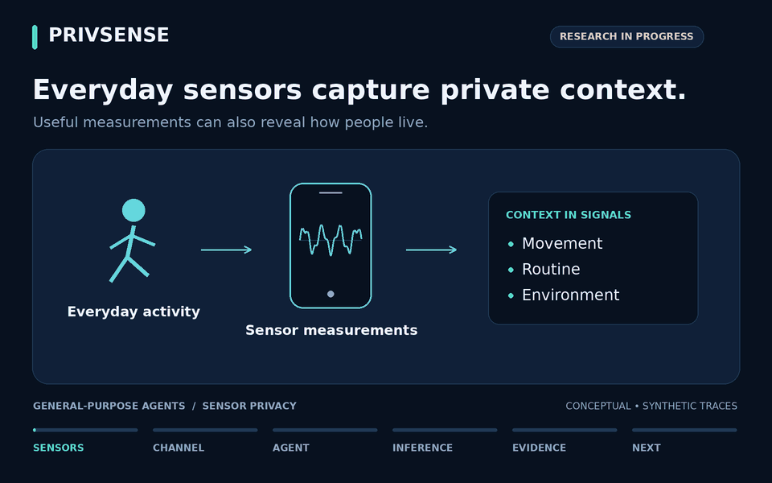

# PrivSense

### Agentic Sensor Side-Channel Analysis

**Can a general-purpose LLM turn the minimal outputs of a sensing system into an adaptive privacy investigation?**

PrivSense is a research project **under active development** exploring that question. We are testing whether LLM agents can plan analyses, select tools, test hypotheses, and reason about sensitive human behavior from constrained sensor interfaces: binary events, coarse outputs, temporal patterns, and eventually multimodal representations.

The vision is an **evidence-driven privacy auditor for edge AI**: an agent that investigates what an exposed interface reveals, explains the evidence behind an inference, and recognizes when the available observations cannot support a reliable conclusion.



*30-second research explainer · synthetic illustrations · [static poster](docs/assets/privsense-explainer-poster.png) · [transcript and editable source](docs/animation/README.md).*

## Why this research matters

Wearables, smartphones, and edge devices increasingly transform rich physical signals into small outputs. A single motion bit can seem innocuous, yet its meaning, repetition, timing, and surrounding context may support behavioral inference. Understanding that risk requires studying both the information available at an interface and the capability of the adversary interpreting it.

PrivSense investigates the next part of that problem: **what changes when the adversary is a general-purpose agent that can adapt its investigation?** We study how planning, tool use, auxiliary knowledge, and observation representation affect practical privacy leakage.

This work is inspired by our PoPETs paper, [*Sensor Privacy as a Spectrum: Quantifying Privacy in Edge and Multimodal Systems through Games*](https://www.petsymposium.org/popets/2026/popets-2026-0124.php), by Jainta Paul, Miles Bovero, Swapnil Saha, Mahesh Chowdhary, Pratik Soni, and Luis Garcia, **PoPETs 2026(4), pp. 341–357**. The paper motivates studying the interaction between observable interfaces, temporal structure, auxiliary context, and cross-modal inference. PrivSense extends that research direction toward adaptive LLM-based adversaries and privacy auditing; its experiments have their own protocols and evidence.

## The research agenda

We aim to connect sensor privacy, agent evaluation, and multimodal learning through five questions:

| Question | What we want to measure |
| --- | --- |
| **Can an agent discover useful attack strategies?** | Whether adaptive tool selection and hypothesis revision improve inference under a fixed observation and query budget. |
| **When does context unlock leakage?** | How temporal continuity, interface semantics, and labeled auxiliary examples change what can be inferred. |
| **Does representation change the attack?** | How binary sequences, run-length encodings, statistics, and visual summaries affect reasoning and reliability. |
| **Can knowledge bridge modalities?** | Whether multimodal agents can connect a permitted low-information channel to sensitive behavioral semantics associated with richer modalities. |
| **Can the result guide interface design?** | Which outputs, aggregation windows, and access policies preserve utility while reducing demonstrated inference risk. |

The intended contribution is a **reproducible experimental framework for agentic sensor privacy research**: explicit attacker knowledge, bounded tools, frozen candidate selection, transparent transcripts, and evaluation that separates genuine evidence from plausible explanations.

## How PrivSense works

```text
Physical activity → sensor processing → exposed interface
                                           │
                              permitted observations only
                                           ▼
                       observe → hypothesize → choose tools
                           ▲                       │
                           └──── validation ───────┘
                                           │
                                  freeze a candidate
                                           ▼
                          independent evaluation + audit
```

The implemented agent receives training summaries and validation feedback through an allowlisted tool interface. It chooses from predefined feature groups and classifiers, revises its experiments, and explicitly submits a candidate. A separate evaluator scores that frozen choice. The agent has no shell, arbitrary code execution, or tool for reading test files.

The broader roadmap will compare this loop with direct LLM inference, fixed-plan agents, conventional classifiers, and budget-matched search. Strong research claims will require repeated subject-disjoint splits, temporal controls, transfer experiments, and uncertainty analysis.

## Current progress

| Component | State |
| --- | --- |
| Bounded tool-using LLM pilot | Implemented: inspect interface, evaluate feature/classifier candidates, submit a frozen selection. |
| Direct inference from binary observations | Implemented, with saved research reports. |
| Temporal context and auxiliary-knowledge screens | Implemented as small exploratory experiments. |
| Binary feature audits and representation comparisons | Implemented, with offline analysis and reports. |
| Multimodal agents and expanded dataset adapters | Planned. |
| Broad evidence of an agentic advantage | An open research question. |

The present pilot uses processed **UTAH-STM-HAR** shake/no-shake outputs and a configured Qwen model. Its bounded feature search provides an initial test bed for adaptive attack selection. The direct-inference screens also expose an important measurement challenge: distinct activities can share exactly the same observable bits, limiting what any interpretation of those observations can establish.

These exploratory results motivate stronger experiments. They do not yet establish general agent superiority, a new vulnerability across all sensing systems, or a privacy guarantee. Historical evaluation subjects have already been inspected; future confirmatory studies need freshly declared evaluation splits.

Explore the evidence in the [direct inference report](reports/direct_llm_inference_pilot.md), [auxiliary-knowledge screen](reports/e3_cross_user_auxiliary_inference.md), [binary feature audit](reports/activity_distinguishing_binary_features.md), and [representation comparison](reports/qwen_representation_comparison.md). The [experiment guide](docs/experiment-guide.md) preserves the detailed protocols and commands.

## Next: multimodal agents

We plan to evaluate agent systems built around **OpenAI GPT multimodal models**, **Google Gemini**, **Anthropic Claude with vision**, and **Qwen-VL / Qwen3-Omni**. These are candidate model families; the current repository does not implement or benchmark all of them. Exact versions, supported tools, modality access, and inference budgets will be frozen for each study. See the official [GPT multimodal introduction](https://openai.com/index/hello-gpt-4o/), [Gemini overview](https://deepmind.google/models/gemini/), [Claude vision documentation](https://platform.claude.com/docs/en/build-with-claude/vision), [Qwen3-VL](https://github.com/QwenLM/Qwen3-VL), and [Qwen3-Omni](https://github.com/QwenLM/Qwen3-Omni).

Planned experiments will give these agents permitted representations such as signal plots, event timelines, and selected auxiliary modalities. Each condition will state exactly what the attacker sees. Richer streams used as reference or oracle baselines will be evaluated as separate access conditions, so an apparent improvement can be attributed to model capability or to additional information.

### Planned dataset suite

We will build outward from UTAH-STM-HAR to three complementary multimodal benchmarks:

| Dataset | Available sensing modalities | Role in the research plan |
| --- | --- | --- |
| **[UTAH-STM-HAR](https://www.petsymposium.org/popets/2026/popets-2026-0124.php)** | Wearable accelerometer and gyroscope recordings across body placements; the current pilot uses processed binary motion outputs. | Anchor the study in constrained edge interfaces and evaluate placement sensitivity. **A processed subset is supported today.** |
| **[UTD-MHAD](https://personal.utdallas.edu/~kehtar/UTD-MHAD.html)** | RGB video, depth, skeletal joints, and wearable inertial signals. | Study inertial-to-visual behavioral inference and cross-modal auxiliary knowledge. **Planned.** |
| **[MMAct](https://mmact19.github.io/2019/)** | RGB, keypoints, acceleration, gyroscope, orientation, Wi-Fi, and pressure. | Examine heterogeneous channels, combinations of exposed outputs, and contextual reasoning. **Planned.** |
| **[NTU RGB+D 120](https://rose1.ntu.edu.sg/dataset/actionRecognition/)** | RGB video, depth, 3D skeletons, and infrared. | Evaluate privacy from derived visual interfaces and transfer across action categories and views. **Planned.** |

Dataset adapters and derived side channels will be defined per benchmark. The expanded suite is a research commitment, not a completed evaluation. Obtain datasets from their official providers under the applicable access terms; raw datasets are not redistributed here.

## Get started

Use Python 3.10 or newer and run commands from the repository root:

```bash
python3 -m venv .venv
source .venv/bin/activate
python -m pip install -r requirements.txt
cp .env.example .env
```

Keep credentials in the ignored `.env` file. Set `OPENROUTER_API_KEY` there only if you intend to run live model inference. The default processed dataset location is `data/source/UTAH-STM-HAR`; use `PRIVSENSE_DATASET` to select another local directory. The expected structure is:

```text
data/source/UTAH-STM-HAR/
└── User <subject>/Processed/<activity>/<placement>*.csv
```

Each processed CSV needs `time[us]` and binary `dec_tree_out_1` columns. Raw public HAR downloads are not automatically interchangeable with these detector-output files; dataset preparation and detector provenance must be established for a new study.

```bash
# Offline checks; historical fixture checks skip when private inputs are absent.
python -m pytest -q

# Prepare locally available processed recordings.
python experiment.py prepare

# Exercise the pipeline without model API calls.
python experiment.py agent --offline --run runs/offline-check
python experiment.py evaluate --run runs/offline-check
```

The offline mode uses a scripted candidate and tests the pipeline. For a live agent run, configure the model and budgets in `configs/pilot.json`, set your API key, and use a new run directory:

```bash
# Live inference incurs provider charges.
python experiment.py agent --run runs/pilot-001
python experiment.py evaluate --run runs/pilot-001
```

Data, run transcripts, credentials, and local machine configuration stay outside tracked source. See [repository hygiene](docs/repository-hygiene.md) for the audit command and [the experiment guide](docs/experiment-guide.md) for information boundaries, optional dependencies, detailed protocols, and historical results.

## Research foundation

If you build on the underlying privacy framework, please cite the PoPETs paper. PrivSense is an ongoing research implementation inspired by it.

```bibtex
@article{paul2026sensorprivacy,
  title   = {Sensor Privacy as a Spectrum: Quantifying Privacy in Edge and Multimodal Systems through Games},
  author  = {Paul, Jainta and Bovero, Miles and Saha, Swapnil and Chowdhary, Mahesh and Soni, Pratik and Garcia, Luis},
  journal = {Proceedings on Privacy Enhancing Technologies},
  volume  = {2026},
  number  = {4},
  pages   = {341--357},
  year    = {2026},
  doi     = {10.56553/popets-2026-0124}
}
```
