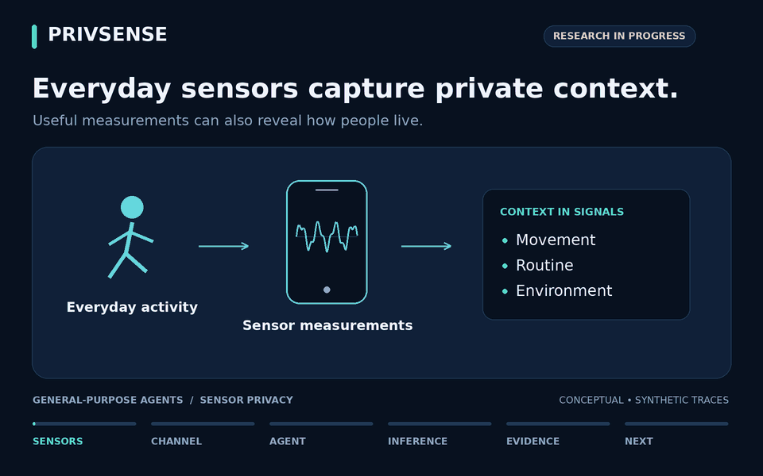

# PrivSense: 30-second research explainer



The animation is a **30-second loop** with six five-second scenes. It illustrates the research direction, rather than a measured attack result. Every waveform and binary trace is synthetic. The current pilot investigates an existing shake/no-shake output; the audio and video streams in the final scene describe planned work.

For a still image or reduced-motion viewing, open the [static overview](../assets/privsense-explainer-poster.png).

| Time | Visual and meaning |
| --- | --- |
| 0–5 s | Everyday activity produces sensor measurements that may encode private context. |
| 5–10 s | Local sensor processing exposes a restricted shake/no-shake channel. Duty cycle, transitions, and temporal runs may still contain structure. |
| 10–15 s | A general-purpose LLM observes summaries, proposes hypotheses, chooses bounded tools, and revises candidates using validation feedback. |
| 15–20 s | Freeze the selected candidate and evaluate it independently on held-out subjects. Report activity inference, uncertainty, failures, and per-subject performance. Test feedback stays outside the agent loop. |
| 20–25 s | Compare baselines, generalization, and ablations to establish what the channel reveals and whether the agent contributes value. These are research questions, rather than claims of completed validation. |
| 25–30 s | Planned work extends the study to multimodal agents and datasets, including motion, audio, and video observations. The goal is reproducible privacy evidence. |

## Regenerate

The editable [generator](generate.py) uses Python 3 and Pillow. It requires the portable `DejaVuSans.ttf` and `DejaVuSans-Bold.ttf` fonts to be discoverable by Pillow. Install DejaVu Sans through your operating system if needed.

```bash
python3 -m pip install Pillow
python3 docs/animation/generate.py
```

The generator samples 300 frames at 100 ms each, produces a 960 × 600 GIF, and verifies an exact playback duration of 30,000 ms. The GIF encoder may merge identical adjacent samples while preserving their combined duration. It also produces the static PNG overview. No network calls, dataset access, API credentials, or model inference are involved.
