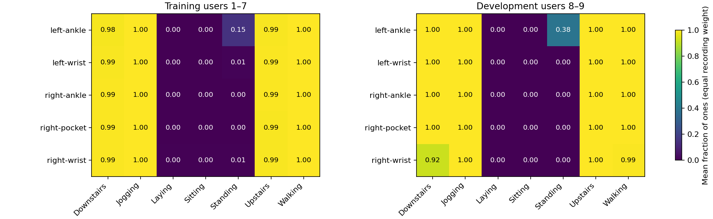
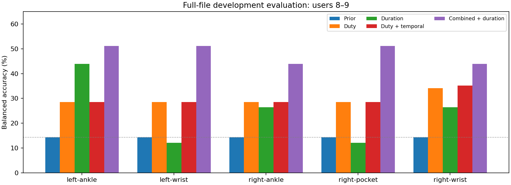

# Activity-distinguishing binary features — restructured Stage 1

Status: implemented and evaluated offline. This is **Stage 1 of the new three-stage research plan**, not a replacement of the earlier E1 zero-shot experiment. No Qwen API calls, fine-tuning, feature-planning agent or detector changes were made. Previous artifacts and source files are preserved.

## 1. Research conclusion

**These interfaces expose useful partial activity information, but do not currently support a robust claim of general seven-class temporal recognition.** Duty cycle distinguishes broad sets of activities. Absolute run durations are highly ranked on training users largely because they encode acquisition length. Sparse nonconstant recordings provide some class associations, but these are not reliably stable across subjects.

Walking versus jogging remains at 50% pairwise balanced accuracy for duty and temporal models at every placement, in both training leave-one-user-out evaluation and users 8–9. Stationary posture distinctions usually collapse; occasional apparent improvements concern one of only four held-out pair examples. The right-wrist stair pair reaches 73.08% held-out temporal balanced accuracy but only 50% mean training-user cross-validation accuracy. This is development evidence of a local association, not a stable signature.

The full-file combined baselines reach 50–52.78% ordinary accuracy, while the corresponding models without explicit duration mostly achieve 11.11%, with right wrist at 27.78%. This difference must be interpreted alongside class weighting, macro-F1, duration controls and acquisition artifacts, not as proof of motion-dynamics extraction.

## 2. Dataset and recording overview

UTAH-STM-HAR processed dec_tree_out_1, all five placements, users 1–9: 915 complete processed files. Users 1–7 provide 735 training/discovery files (147 per placement); users 8–9 provide 180 development files (36 per placement). Users 10–11 were not opened and remain previously inspected, not an untouched test. Each file has one dataset-assigned activity label. File-level label purity within the recording is assumed from that annotation, not independently established.

All timestamps and bits were read unchanged. Monotonicity, binary values and 20,000-µs within-file spacing were checked. Every analyzed file is continuous at this export cadence; no boundary is bridged. Sample coverage is N×0.02 seconds; timestamp span is (N−1)×0.02 seconds. Recorded shake output does not imply continuous physical motion, and 50-Hz exports do not establish 50 independent detector decisions per second.

| Placement | Training variable files /147 | Training transitions | Evaluation variable files /36 | Evaluation transitions |
|---|---:|---:|---:|---:|
| left-ankle | 17 | 34 | 1 | 52 |
| left-wrist | 19 | 44 | 0 | 0 |
| right-ankle | 15 | 21 | 1 | 2 |
| right-pocket | 17 | 30 | 0 | 0 |
| right-wrist | 18 | 62 | 7 | 46 |

Evaluation variation occurs in User 9 Standing (left ankle), User 8 Standing (right ankle), and User 9 Downstairs/Walking (right wrist). Left wrist and right pocket evaluation files are constant. Stair files are numerous fragments; they are not independent participants or necessarily independent sessions. The file-weighted evaluation has 13 Downstairs and 13 Upstairs files, but only two files for each other activity.

Per-file features, complete observed run-length lists, transition indices, segment summaries, periodicity candidates and source hashes: [recording_features.json](activity_feature_audit/recording_features.json). Flat table: [recording_features.csv](activity_feature_audit/recording_features.csv).

## 3. Candidate feature definitions and information boundaries

| Feature | Definition | Interpretation / caveat |
|---|---|---|
| Duty cycle | mean(binary); zero fraction = 1−mean | Marginal bit information, independent of ordering |
| Transition count | Number of adjacent unequal samples | Order-sensitive, but also scales with observed duration |
| Transition rate | count / timestamp span in seconds | Exposure-normalized; still can carry duration/update-grid artifacts |
| Zero/one runs | Consecutive lengths for each bit; mean, median, maximum, 90th percentile | Observed detector bouts, not verified physical bouts |
| Run durations | Run samples × 0.02 seconds | On a constant file, maximum and mean occupied-bit run equal file duration |
| Run fractions | Run length / N | Omits explicit duration, but is not guaranteed free of exposure artifacts |
| Segment variability | Ten equal-count chronological bins: duty standard deviation, range, linear slope over normalized time | Describes onset/location changes; may capture startup/export behavior |
| First/last contrast | Last-bin duty minus first-bin duty | Boundary-sensitive; no hidden activity boundary is used |
| Lag correlation | Pearson correlation at lags 1 and 50 samples | 0 used internally when undefined; constant-stream correlation is not actually measured zero |
| Binary entropy | −Σ p log2 p | Marginal information only; cannot demonstrate temporal order |
| Candidate periodicity | Repeated-bout eligibility plus an interior positive autocorrelation peak | Screening diagnostic, never assumed to be gait periodicity |
| Duration | N×0.02, kept as a distinct access factor | May encode acquisition protocol rather than behavior |

The first and last observed runs are marked boundary-censored: their true bouts may extend beyond the file. Empty bit-state run lists are stored as empty lists, with summary zero only as an internal model convention. Never present an absent run as an observed zero-second bout. “Active/inactive” here refers only to detector 1/0. The feature extractor uses no labels, filenames, subject identity, raw IMU, source schedule or hidden class boundaries.

The periodicity rule requires at least six transitions and three one-runs, then checks one-second-spaced lags from 1 second to min(20 seconds, one third of the recording). It selects an interior autocorrelation maximum above 0.3; otherwise periodicity is unavailable, not zero. These fixed thresholds are diagnostic choices, not optimized against activity accuracy. The lag grid reflects the observed held-output structure and limits resolvable recurrence. A candidate peak can arise from irregular events and does not validate a physical period.

**Duration leakage warning:** removing a field named duration is insufficient. Absolute run lengths directly expose it on constant files. Even transition rates and normalized run fractions may reveal exposure through the one-second quantization grid. The no-explicit-duration baseline excludes absolute run seconds, sample count and raw transition count; fixed-duration comparisons provide the stronger control.

## 4. Training-only feature distributions and subject consistency

Discovery uses users 1–7 only. Each activity/placement table contains file-level min/quartiles/median/max and seven subject-level means; the standard deviation of those means quantifies within-class cross-subject variation without treating stair fragments as separate people. All candidate distributions are in [training_feature_distributions.json](activity_feature_audit/training_feature_distributions.json).



The left panel is discovery evidence; the right panel is descriptive validation, never used for feature selection. Values average complete files and therefore differ from window-weighted earlier reports.

| Placement | Activity | Training duty min / median / max | SD of subject-mean duty | Transition count min–max |
|---|---|---|---:|---|
| left-ankle | Downstairs | 0.6347 / 1.0000 / 1.0000 | 0.0454 | 0–1 |
| left-ankle | Jogging | 1.0000 / 1.0000 / 1.0000 | 0.0000 | 0–0 |
| left-ankle | Laying | 0.0000 / 0.0000 / 0.0067 | 0.0023 | 0–2 |
| left-ankle | Sitting | 0.0000 / 0.0000 / 0.0000 | 0.0000 | 0–0 |
| left-ankle | Standing | 0.0000 / 0.0000 / 1.0000 | 0.3479 | 0–12 |
| left-ankle | Upstairs | 0.8950 / 1.0000 / 1.0000 | 0.0308 | 0–1 |
| left-ankle | Walking | 1.0000 / 1.0000 / 1.0000 | 0.0000 | 0–0 |
| left-wrist | Downstairs | 0.9090 / 1.0000 / 1.0000 | 0.0268 | 0–2 |
| left-wrist | Jogging | 1.0000 / 1.0000 / 1.0000 | 0.0000 | 0–0 |
| left-wrist | Laying | 0.0000 / 0.0000 / 0.0100 | 0.0035 | 0–2 |
| left-wrist | Sitting | 0.0000 / 0.0000 / 0.0033 | 0.0017 | 0–2 |
| left-wrist | Standing | 0.0000 / 0.0067 / 0.0234 | 0.0097 | 0–12 |
| left-wrist | Upstairs | 0.8987 / 1.0000 / 1.0000 | 0.0281 | 0–1 |
| left-wrist | Walking | 1.0000 / 1.0000 / 1.0000 | 0.0000 | 0–0 |
| right-ankle | Downstairs | 0.9098 / 1.0000 / 1.0000 | 0.0192 | 0–2 |
| right-ankle | Jogging | 1.0000 / 1.0000 / 1.0000 | 0.0000 | 0–0 |
| right-ankle | Laying | 0.0000 / 0.0000 / 0.0000 | 0.0000 | 0–0 |
| right-ankle | Sitting | 0.0000 / 0.0000 / 0.0000 | 0.0000 | 0–0 |
| right-ankle | Standing | 0.0000 / 0.0000 / 0.0033 | 0.0015 | 0–2 |
| right-ankle | Upstairs | 0.9348 / 1.0000 / 1.0000 | 0.0185 | 0–2 |
| right-ankle | Walking | 1.0000 / 1.0000 / 1.0000 | 0.0000 | 0–0 |
| right-pocket | Downstairs | 0.8948 / 1.0000 / 1.0000 | 0.0238 | 0–1 |
| right-pocket | Jogging | 1.0000 / 1.0000 / 1.0000 | 0.0000 | 0–0 |
| right-pocket | Laying | 0.0000 / 0.0000 / 0.0000 | 0.0000 | 0–0 |
| right-pocket | Sitting | 0.0000 / 0.0000 / 0.0100 | 0.0035 | 0–4 |
| right-pocket | Standing | 0.0000 / 0.0000 / 0.0067 | 0.0029 | 0–4 |
| right-pocket | Upstairs | 0.8987 / 1.0000 / 1.0000 | 0.0305 | 0–3 |
| right-pocket | Walking | 1.0000 / 1.0000 / 1.0000 | 0.0000 | 0–0 |
| right-wrist | Downstairs | 0.8726 / 1.0000 / 1.0000 | 0.0261 | 0–5 |
| right-wrist | Jogging | 1.0000 / 1.0000 / 1.0000 | 0.0000 | 0–0 |
| right-wrist | Laying | 0.0000 / 0.0000 / 0.0233 | 0.0079 | 0–6 |
| right-wrist | Sitting | 0.0000 / 0.0000 / 0.0300 | 0.0105 | 0–8 |
| right-wrist | Standing | 0.0000 / 0.0000 / 0.0267 | 0.0103 | 0–14 |
| right-wrist | Upstairs | 0.8987 / 1.0000 / 1.0000 | 0.0279 | 0–2 |
| right-wrist | Walking | 1.0000 / 1.0000 / 1.0000 | 0.0000 | 0–0 |

Constant patterns dominate. Jogging and Walking are all-one in the training files at these placements; most stair files are also all-one, with some startup zeros. Laying/Sitting/Standing are often all-zero but occasional reference subjects have short positive bursts. Those within-class exceptions must be retained rather than treated as unique activity signatures.

Periodicity candidates in the complete files:
- left-wrist, User 5, Standing: candidate 2 s, correlation 0.415; source `User 5/Processed/Standing/left-wrist.csv`.
- right-wrist, User 9, Downstairs: candidate 10 s, correlation 0.304; source `User 9/Processed/Downstairs/right-wrist/right-wrist_down2.csv`.
- right-wrist, User 9, Downstairs: candidate 2 s, correlation 0.313; source `User 9/Processed/Downstairs/right-wrist/right-wrist_down5.csv`.
- right-wrist, User 9, Walking: candidate 5 s, correlation 0.326; source `User 9/Processed/Walking/right-wrist.csv`.

There is only one training candidate (left-wrist Standing, User 5), and the validation candidates are in right-wrist User 9 recordings. No common activity/placement periodic signature is established across participants. Periodicity is not recommended as a primary ICL feature.

### Training-only usefulness ranking

For each feature, fit a depth-2 class-balanced decision tree in seven leave-one-training-user-out folds. Rank by mean subject balanced accuracy; no users 8–9 score enters ranking. These rankings are exploratory comparisons on the same seven folds, not nested unbiased estimates of a selected best feature. The main baseline feature families were specified before evaluating them and were not chosen by validation success.

| Placement | Top three full-file features: mean training-user balanced accuracy | Top fixed-10-second feature |
|---|---|---|
| left-ankle | max_one_run_seconds: 42.86%; mean_one_run_seconds: 42.86%; max_zero_run_seconds: 36.96% | fraction_ones: 28.57% |
| left-wrist | max_one_run_seconds: 48.79%; mean_one_run_seconds: 48.79%; fraction_ones: 34.69% | segment_duty_slope: 26.19% |
| right-ankle | max_one_run_seconds: 40.82%; mean_one_run_seconds: 40.82%; segment_duty_slope: 33.16% | fraction_ones: 29.08% |
| right-pocket | max_one_run_seconds: 46.94%; mean_one_run_seconds: 46.94%; max_one_run_fraction: 34.69% | fraction_ones: 30.61% |
| right-wrist | max_one_run_seconds: 44.71%; mean_one_run_seconds: 44.71%; duration_seconds: 31.09% | mean_one_run_fraction: 28.83% |

Full rankings and per-subject fold metrics: [training_feature_ranking.json](activity_feature_audit/training_feature_ranking.json). Absolute positive-run duration ranks highly because it jointly identifies shake status and natural recording length. At fixed 10 seconds, candidate scores cluster around coarse two-group discrimination; no consistently superior temporal feature emerges. Do not promote a high full-file run-duration score as evidence of rhythmic motion.

## 5. Activity-pair distinguishability and collisions

Pair classifiers are separate two-candidate diagnostic tasks. They assume the evaluator has restricted the possibilities to that pair; their accuracy is not a seven-class result. Each uses training-only fitting, depth 2, minimum leaf size 3, balanced class weights and fixed random state. The table reports training-user mean balanced accuracy → validation balanced accuracy for the temporal family (duty plus normalized temporal features).

| Placement | Walking–Jogging | Downstairs–Upstairs | Laying–Sitting | Laying–Standing | Sitting–Standing |
|---|---|---|---|---|---|
| left-ankle | 50.0% → 50.0% | 48.8% → 50.0% | 50.0% → 50.0% | 57.1% → 75.0% | 50.0% → 75.0% |
| left-wrist | 50.0% → 50.0% | 50.0% → 50.0% | 64.3% → 50.0% | 71.4% → 50.0% | 71.4% → 50.0% |
| right-ankle | 50.0% → 50.0% | 50.0% → 50.0% | 50.0% → 50.0% | 50.0% → 50.0% | 50.0% → 50.0% |
| right-pocket | 50.0% → 50.0% | 53.0% → 50.0% | 50.0% → 50.0% | 50.0% → 50.0% | 64.3% → 50.0% |
| right-wrist | 50.0% → 50.0% | 50.0% → 73.1% | 64.3% → 50.0% | 42.9% → 50.0% | 64.3% → 50.0% |

All 21 pairs, duty-only and duration-only comparators, and target-shuffle pair controls are in [activity_pair_results.json](activity_feature_audit/activity_pair_results.json). Walking/Jogging and stationary-posture pairs have only four evaluation files each; stairs have 26. A 75% posture score is only three correct files out of four, not strong generalization evidence.

Stable conclusions:
- **Walking versus Jogging:** the binary value/run pattern supplies no reliable distinction here. Different file lengths can create apparent duration-based separation, but that is not verified behavior-specific information.
- **Upstairs versus Downstairs:** training temporal differences are weak/inconsistent. Right-wrist validation reaches 73.08%, but mean training-user accuracy is 50%, so it is not a stable discovered signature.
- **Sitting versus Standing versus Laying:** identical zero streams remain common. Left-wrist training Standing/posture differences fail on users 8–9, where the streams are all zero. Left-ankle exceptions concern one variable Standing file.
- **Coarse moving versus stationary grouping:** supported much more strongly than exact activity, with placement-specific exceptions. Shake is not a universally correct physical-motion label.

Observational collisions are recorded in [observational_collisions.json](activity_feature_audit/observational_collisions.json). Standardized first-100-sample strings collapse multiple labels; full constant strings differ only by count of repeated bits. Among full constant files, all-one groups include multiple moving activities and all-zero groups include multiple postures. A deterministic feature function cannot separate identical permitted observations. A classifier can only tie-break using priors; extra decimal precision or invented physiology does not add information.

## 6. Conventional cross-user inference results

Main full-recording models train on all 147 users 1–7 files per placement and evaluate 36 users 8–9 files. No random window split or subject overlap occurs. Class prior is the empirical most-frequent training class. Other baselines are fixed depth-3 decision trees with minimum leaf size 3, balanced class weights and random_state=42. No hyperparameter search, validation-based feature selection or retraining on evaluation labels was performed.

Feature families: duty=fraction of ones; duration=duration_seconds; temporal=duty plus transition rate, normalized mean/max runs for each bit, segment duty spread/slope and lags 1/50 correlations; combined adds duration to that temporal family. Each fitted tree, all predictions, all confusion matrices, training LOSO metrics and subject results are in [cross_user_results.json](activity_feature_audit/cross_user_results.json).



| Placement | Baseline | Accuracy | Macro-F1 | Balanced accuracy | User 8 accuracy | User 9 accuracy |
|---|---|---:|---:|---:|---:|---:|
| left-ankle | class_prior | 36.11% | 0.0758 | 14.29% | 36.84% | 35.29% |
| left-ankle | duty_cycle | 11.11% | 0.0995 | 28.57% | 10.53% | 11.76% |
| left-ankle | duration_only | 50.00% | 0.3786 | 43.96% | 42.11% | 58.82% |
| left-ankle | temporal_no_explicit_duration | 11.11% | 0.0989 | 28.57% | 10.53% | 11.76% |
| left-ankle | combined_with_duration | 52.78% | 0.4031 | 51.10% | 47.37% | 58.82% |
| left-wrist | class_prior | 36.11% | 0.0758 | 14.29% | 36.84% | 35.29% |
| left-wrist | duty_cycle | 11.11% | 0.0893 | 28.57% | 10.53% | 11.76% |
| left-wrist | duration_only | 30.56% | 0.1080 | 12.09% | 36.84% | 23.53% |
| left-wrist | temporal_no_explicit_duration | 11.11% | 0.0893 | 28.57% | 10.53% | 11.76% |
| left-wrist | combined_with_duration | 52.78% | 0.4119 | 51.10% | 52.63% | 52.94% |
| right-ankle | class_prior | 36.11% | 0.0758 | 14.29% | 36.84% | 35.29% |
| right-ankle | duty_cycle | 11.11% | 0.0893 | 28.57% | 10.53% | 11.76% |
| right-ankle | duration_only | 36.11% | 0.1599 | 26.37% | 42.11% | 29.41% |
| right-ankle | temporal_no_explicit_duration | 11.11% | 0.0893 | 28.57% | 10.53% | 11.76% |
| right-ankle | combined_with_duration | 50.00% | 0.2976 | 43.96% | 47.37% | 52.94% |
| right-pocket | class_prior | 36.11% | 0.0758 | 14.29% | 36.84% | 35.29% |
| right-pocket | duty_cycle | 11.11% | 0.0893 | 28.57% | 10.53% | 11.76% |
| right-pocket | duration_only | 30.56% | 0.1080 | 12.09% | 36.84% | 23.53% |
| right-pocket | temporal_no_explicit_duration | 11.11% | 0.0893 | 28.57% | 10.53% | 11.76% |
| right-pocket | combined_with_duration | 52.78% | 0.4221 | 51.10% | 52.63% | 52.94% |
| right-wrist | class_prior | 36.11% | 0.0758 | 14.29% | 36.84% | 35.29% |
| right-wrist | duty_cycle | 25.00% | 0.1728 | 34.07% | 10.53% | 41.18% |
| right-wrist | duration_only | 36.11% | 0.1969 | 26.37% | 36.84% | 35.29% |
| right-wrist | temporal_no_explicit_duration | 27.78% | 0.1836 | 35.16% | 10.53% | 47.06% |
| right-wrist | combined_with_duration | 50.00% | 0.3032 | 43.96% | 47.37% | 52.94% |

**Why a prior can beat an informative feature on ordinary accuracy:** stairs dominate the file counts. Always predicting Downstairs gets 13/36=36.11%, but only 14.29% balanced accuracy and 0.0758 macro-F1. A class-balanced tree that distinguishes zero/one groups but guesses Jogging and Laying may get only 4/36=11.11%, yet 28.57% balanced accuracy. This is a class-preference/weighting effect, not evidence that observing bits reduces available information. Do not compare these file-weighted scores directly with earlier balanced 14-target screens or window-weighted evaluations.

Models without explicit duration do not consistently improve over duty alone. Right wrist improves from 25% to 27.78% (one additional file), concentrated in User 9. That modest change and the occasional pair improvement need stronger cross-user evidence before recommending an activity-specific temporal feature. The classifier is a baseline, not an information-theoretic optimum.

## 7. Duration and acquisition confounds

Stair files are short processed segments (roughly 3.58–54.96 seconds); most other activities are approximately five minutes. Natural duration is therefore associated with the collection/segmentation protocol. Subject- and placement-specific tail counts introduce additional fingerprints. Neither total duration nor absolute longest-run duration should be described as a motion-dynamics discovery.

Full-file combined models achieve roughly 50–52.78% ordinary accuracy, but comparable duty/temporal models generally cannot separate the seven labels. This is consistent with duration adding useful dataset-specific information. It does not show that it will generalize to arbitrary activity durations. Duration is a legitimate observable if the attacker sees a natural file boundary, but that is a distinct threat model from receiving a fixed-rate fixed-length stream.

For the duration-controlled study, retain only files with at least 500 samples (142 training files per placement, all 36 evaluation files). Compare the same recording IDs using the first 100 samples, first 500 samples and full file. Prefix selection is predetermined, not based on labels or performance. Five short training stair fragments are excluded uniformly. One prediction is evaluated per source recording in every condition. This is different from the previous audit that used every nonoverlapping ten-second interval; their metrics should not be pooled.

## 8. Temporal coherence: short, long, complete and disrupted

| Placement | 2-second prefix temporal accuracy | 10-second prefix temporal accuracy | Full temporal accuracy | Full target shuffled, same trained model | Full train and target shuffled, refit |
|---|---:|---:|---:|---:|---:|
| left-ankle | 41.67% | 11.11% | 11.11% | 11.11% | 11.11% |
| left-wrist | 11.11% | 11.11% | 11.11% | 11.11% | 11.11% |
| right-ankle | 11.11% | 11.11% | 11.11% | 11.11% | 11.11% |
| right-pocket | 11.11% | 11.11% | 11.11% | 11.11% | 11.11% |
| right-wrist | 11.11% | 11.11% | 27.78% | 27.78% | 16.67% |

All five baseline families, fixed-length disruption controls and coverage counts are in [temporal_coherence.json](activity_feature_audit/temporal_coherence.json). The shuffled control permutes complete 50-sample blocks within the same file and retains any partial tail in place. This preserves every bit, sample count and proportion, while changing adjacency/run structure. It is explicitly an artificial order-control observation, not a new natural recording; no unrelated files are concatenated. Source recordings are never modified.

What the comparisons establish:
- **More observations:** full right-wrist files expose variation missed by the first 100/500 samples, and both duty and temporal scores improve. This is compatible with more accurate marginal estimates or rare-event exposure; it does not isolate order.
- **Temporal ordering:** the full temporal model has exactly the same aggregate accuracy after target block shuffling at all placements. Individual predictions may change. Refitting on shuffled training examples changes the learned rule and is a separate distribution-perturbation control, not clean proof of temporal utility.
- **Statistical characteristics:** duty changes and observed run statistics can reveal coarse state or sparse anomalies. Most constant traces collapse those features to identical values.
- **Duration/artifacts:** full-length gains from duration-inclusive models can arise from segmented stairs, long steady recordings, startup transients and sample-count fingerprints.

The large left-ankle 2-second versus 10-second accuracy change is a warning against equating longer input with more useful information: the fitted class-balanced tree changes its preferred label within an ambiguous constant group when its training prefixes change. Both duty and temporal models exhibit that change. It is not evidence that two seconds reveal more physiology than complete recordings.

Order controls are only one fixed permutation per recording, not repeated perturbation estimates. Constant files are invariant. A null result for a shallow tree does not prove order contains no information, and a change after shuffling can reflect distribution shift rather than useful temporal inference. Most evaluation variation remains concentrated in one user, so strong population claims are unsupported.

## 9. Recommended features for future Qwen ICL

The ranking below combines training-only usefulness/stability with the held-out falsification checks; it is a research recommendation, not a validation-tuned feature model. Keep the full computed feature table for reproducibility, but do not flood an LLM prompt with redundant columns.

| Priority | Feature family | Recommended use |
|---|---|---|
| 1 | Fraction of ones | Compact, stable marginal information; strongest defensible coarse grouping signal |
| 2 | Transition count at a common fixed duration | State whether change exists; diagnostic rather than established seven-class discriminator |
| 3 | Maximum zero/one run fraction | Compact persistence summary; test its incremental value beyond duty, preserve boundary-censor caveat |
| 4 | Ten chronological segment duty values | Optional order-explicit diagnostic; no robust accuracy benefit established |
| Separate factor | Total duration / absolute run seconds | Expose only in a declared duration-access condition; acquisition information |
| Defer | Estimated period, autocorrelation spectrum, many near-duplicate statistics | Too sparse or unstable to justify a primary activity signature |

Features that failed to generalize include left-wrist stationary posture duty/run differences, right-pocket sitting/standing training differences, and nominal periodicity candidates. A high training rank for absolute run length fails the intended duration-free interpretation even if it predicts dataset labels. Right-wrist stair associations are not yet stable across subjects.

A compact fixed-duration representation for a future experiment is:

```json
{
  "observation_seconds": 10,
  "fraction_ones": "computed number",
  "transition_count": "computed integer",
  "max_zero_run_fraction": "computed number",
  "max_one_run_fraction": "computed number"
}
```

The quoted values above are type placeholders, not fabricated observed data. For actual inputs, compute exact values from the permitted binary interval, round fractions identically to four decimals, and retain full precision in evaluator logs. A zero maximum for an absent state means no such run occurred; provide that definition once. Do not include estimated physical cadence, source file length, subject, recording path, labels of target segments or model predictions. Features are a deterministic function of the exposed bits and known sampling interval; they add computational assistance, not new sensor information.

For ICL, each authorized reference object contains `activity` plus the same feature object; the target contains the feature object only. The system explains units, detector semantics, common duration, and boundary-censored runs. Qwen receives no classical classifier output. Maintain a raw-binary counterpart to test whether precomputed features improve the LLM’s use of already available information, rather than its access to new observations.

## 10. Smallest scientifically meaningful restructured Stage 2

**Propose a 50-request development screen, after the separately proposed v2 schema technical gate passes. No calls are authorized or executed by this Stage 1 task.** Reuse the already frozen five-placement panel in `reports/next_inference_audit/proposed_pilot_selection.json` (15 targets: ten constant controls and five naturally varying intervals). This avoids choosing a placement or recording because it scored well in this feature analysis. The same nine training-reference intervals per placement supply the references: seven class-covering intervals plus two declared varying examples from training users only. Reference class imbalance is explicit; it is not a population prior.

All observations are real 500-sample/10-second intervals from one source file. Users 8–9 targets are absent from users 1–7 references. References remain independent recordings, never stitched into chronology. This tests fixed-duration intervals, not natural-length full files. The complete-file discovery above justified controlling that change in observation extent.

| Cell | Representation of same target and references | Requests |
|---|---|---:|
| R | All 500 raw binary values as lossless strings | 15 |
| D | Duty fraction only; shared 10-second duration | 15 |
| T | Duty, transition count, maximum zero/one run fractions | 15 |
| T-order control | T computed after a declared within-recording block permutation of each of the five varying targets; chronological references unchanged | 5 |

The count-only features must remain exactly invariant to permutation. Ensure the control changes the varying target order while preserving block multiset and total ones; constant controls do not need duplicate shuffle calls. Use one fixed seed and freeze all payloads before Qwen. More decimal digits, different wording or a longer class list must not vary across cells. Only representation fields differ. Do not show the shuffle condition name to Qwen or falsely assert that an altered control is authentic chronology.

Use the proposed three-field v2 output contract, pinned provider and fixed model settings after label-blind technical validation; that gate has not yet run. Example instruction:

```text
Infer the activity of the unlabeled target interval using only the supplied observations or deterministic features and labeled reference intervals from other participants. Every interval has the same duration. The binary interface reports shake/no shake and does not directly measure intensity, posture or gait cadence. Identical feature values may correspond to different activities. Return only predicted_activity, confidence for the exact activity, and sufficient_information under the response schema.
```

The experiment asks whether T improves over D, whether features help versus R on the same information, and whether T is sensitive to order manipulation. Evaluate paired accuracy, macro-F1 with class supports, confusion, moving/stationary grouping, calibration summaries, insufficiency and schema failure rate. Recompute the simple baselines on exactly the same supplied references; do not feed their outputs to Qwen. Report each placement and the varying/constant strata separately, with individual predictions. Single-repeat results are diagnostic; later repetitions require a separate decision, not automatic expansion.

The selected varying intervals cover only Standing at the ankles and Downstairs at the right wrist, with severe subject/session concentration. Therefore this screen cannot validate robust seven-class generalization or a universal temporal attack. It can distinguish a failure to use marginal statistics, a failure to extract simple features from long digit strings, and sensitivity to run ordering. Improvements over raw strings would be evidence of computational assistance, not newly revealed sensor information.

## 11. Research decision

**Partial inference is scientifically justified; reliable seven-class temporal inference is not yet established.** Coarse binary distinctions are observable, and duration can expose acquisition-specific private-label associations. Several exact activity pairs remain observationally indistinguishable when duration is controlled. Report those equivalence groups rather than forcing a claim that every class has a binary signature.

A stronger legitimate interface would need documented event semantics/update timing, real within-session variation that repeats across multiple people and sessions, authentic continuous recordings, sufficient duration-controlled observations across activities, and labels independent of the detector-generation process. It should also include constant/ambiguous intervals and realistic prevalence. Do not alter the existing detector, derive binary outputs from private activity labels, or tune thresholds to maximize attack accuracy. Independently verify information content before large LLM or autonomous-agent experiments.

## Reproducibility

Offline implementation: `scripts/discover_binary_features.py`; report/figures: `scripts/report_binary_features.py`; unit checks: `tests/test_binary_features.py`. Install `requirements-feature-analysis.txt` in the project environment, then run `.venv/bin/python -m scripts.discover_binary_features` and `.venv/bin/python -m scripts.report_binary_features` from the repository root. Matplotlib is needed only for the standalone figures. The analysis manifest records versions, features, partitions, fixed hyperparameters and disruption rules. JSON/CSV artifacts include all training distributions, rankings, 21 pair comparisons per placement, complete confusion matrices and individual predictions. PNG and SVG figures are standalone exports. Preserved artifact hashes are in `activity_feature_audit/preservation.json`.

No new inference calls, agent framework or fine-tuning were performed. Feature discovery and fitting used users 1–7 only; users 8–9 were used for development evaluation and explicit falsification, with no claim that they are untouched.

## Appendix: full-file confusion matrices

Rows and columns follow Downstairs, Jogging, Laying, Sitting, Standing, Upstairs, Walking. The linked results JSON also contains every baseline matrix and individual predictions.

### left-ankle — temporal_no_explicit_duration

```json
[[0, 13, 0, 0, 0, 0, 0], [0, 2, 0, 0, 0, 0, 0], [0, 0, 0, 2, 0, 0, 0], [0, 0, 0, 2, 0, 0, 0], [0, 1, 0, 1, 0, 0, 0], [0, 13, 0, 0, 0, 0, 0], [0, 2, 0, 0, 0, 0, 0]]
```

### left-ankle — combined_with_duration

```json
[[2, 0, 0, 0, 0, 11, 0], [0, 2, 0, 0, 0, 0, 0], [0, 0, 1, 1, 0, 0, 0], [0, 0, 0, 2, 0, 0, 0], [0, 1, 0, 1, 0, 0, 0], [1, 0, 0, 0, 0, 12, 0], [0, 2, 0, 0, 0, 0, 0]]
```

### left-wrist — temporal_no_explicit_duration

```json
[[0, 13, 0, 0, 0, 0, 0], [0, 2, 0, 0, 0, 0, 0], [0, 0, 2, 0, 0, 0, 0], [0, 0, 2, 0, 0, 0, 0], [0, 0, 2, 0, 0, 0, 0], [0, 13, 0, 0, 0, 0, 0], [0, 2, 0, 0, 0, 0, 0]]
```

### left-wrist — combined_with_duration

```json
[[2, 0, 0, 0, 0, 11, 0], [0, 2, 0, 0, 0, 0, 0], [0, 0, 2, 0, 0, 0, 0], [0, 0, 2, 0, 0, 0, 0], [0, 0, 2, 0, 0, 0, 0], [1, 0, 0, 0, 0, 12, 0], [0, 1, 0, 0, 0, 0, 1]]
```

### right-ankle — temporal_no_explicit_duration

```json
[[0, 13, 0, 0, 0, 0, 0], [0, 2, 0, 0, 0, 0, 0], [0, 0, 2, 0, 0, 0, 0], [0, 0, 2, 0, 0, 0, 0], [0, 0, 2, 0, 0, 0, 0], [0, 13, 0, 0, 0, 0, 0], [0, 2, 0, 0, 0, 0, 0]]
```

### right-ankle — combined_with_duration

```json
[[2, 0, 0, 0, 0, 11, 0], [0, 0, 0, 0, 0, 0, 2], [0, 0, 2, 0, 0, 0, 0], [0, 0, 2, 0, 0, 0, 0], [0, 0, 2, 0, 0, 0, 0], [1, 0, 0, 0, 0, 12, 0], [0, 0, 0, 0, 0, 0, 2]]
```

### right-pocket — temporal_no_explicit_duration

```json
[[0, 13, 0, 0, 0, 0, 0], [0, 2, 0, 0, 0, 0, 0], [0, 0, 2, 0, 0, 0, 0], [0, 0, 2, 0, 0, 0, 0], [0, 0, 2, 0, 0, 0, 0], [0, 13, 0, 0, 0, 0, 0], [0, 2, 0, 0, 0, 0, 0]]
```

### right-pocket — combined_with_duration

```json
[[2, 0, 0, 0, 0, 11, 0], [0, 1, 0, 0, 0, 0, 1], [0, 0, 2, 0, 0, 0, 0], [0, 0, 2, 0, 0, 0, 0], [0, 0, 1, 1, 0, 0, 0], [1, 0, 0, 0, 0, 12, 0], [0, 0, 0, 0, 0, 0, 2]]
```

### right-wrist — temporal_no_explicit_duration

```json
[[6, 7, 0, 0, 0, 0, 0], [0, 2, 0, 0, 0, 0, 0], [0, 0, 0, 2, 0, 0, 0], [0, 0, 0, 2, 0, 0, 0], [0, 0, 0, 2, 0, 0, 0], [0, 13, 0, 0, 0, 0, 0], [0, 2, 0, 0, 0, 0, 0]]
```

### right-wrist — combined_with_duration

```json
[[2, 0, 0, 0, 2, 9, 0], [0, 0, 0, 0, 0, 0, 2], [0, 0, 0, 2, 0, 0, 0], [0, 0, 0, 2, 0, 0, 0], [0, 0, 0, 2, 0, 0, 0], [1, 0, 0, 0, 0, 12, 0], [0, 0, 0, 0, 0, 0, 2]]
```
